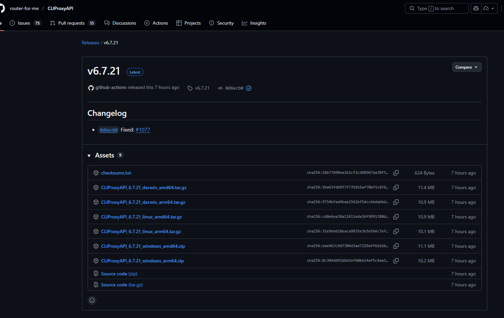
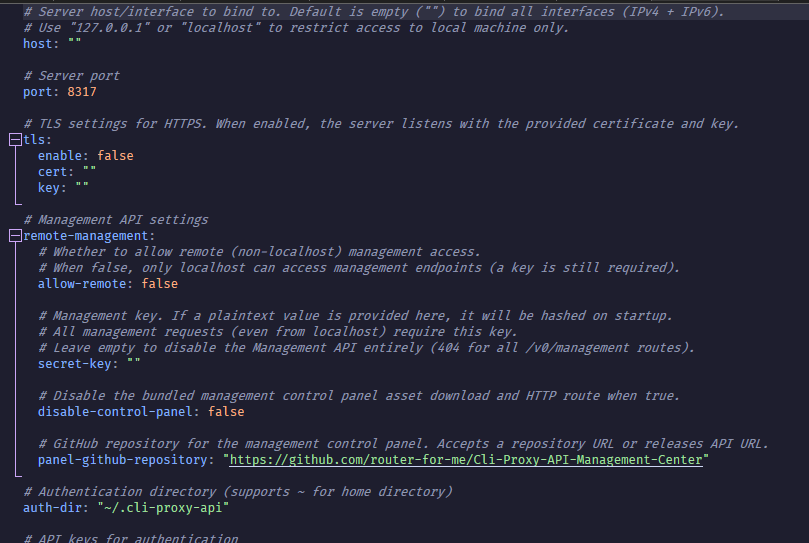
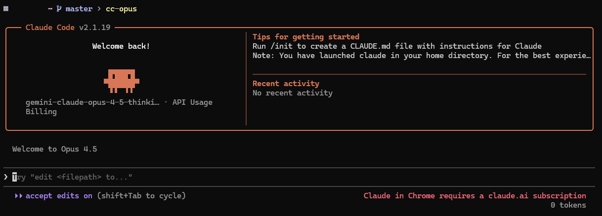

"Bạn yêu thích khả năng coding của Claude Code nhưng đau ví vì API cost? Hay bạn muốn dùng context siêu to khổng lồ của Gemini 3 Pro ngay trong giao diện dòng lệnh của Anthropic? Bài viết này sẽ giúp bạn biến Claude Code thành công cụ 'bá đạo' nhất với sự trợ giúp của CLIPROXYAPI.
## CLIPROXYAPI là gì?
Link: https://github.com/router-for-me/CLIProxyAPI

CLIProxyAPI là một proxy API server mạnh mẽ dành cho các công cụ AI CLI như Claude Code, Gemini CLI, ChatGPT Codex và nhiều coding cli tool khác. Dự án cung cấp một API endpoint thống nhất tương thích với các chuẩn OpenAI, Claude, Gemini… để chúng ta có thể dễ dàng quản lý xác thực OAuth, điều phối yêu cầu đến nhiều nhà cung cấp AI khác nhau, và chuyển đổi định dạng API tự động - giúp các công cụ CLI sử dụng các model AI khác nhau một cách liền mạch mà không cần API key riêng từng dịch vụ.
## Tại sao lại là Claude Code?
Claude Code là công cụ AI CLI hỗ trợ developer làm việc trực tiếp với code trong terminal, từ phân tích codebase, viết và refactor code đến debug và giải thích logic. Điểm mạnh của Claude Code nằm ở khả năng hiểu ngữ cảnh code lớn và reasoning sâu, giúp xử lý hiệu quả các tác vụ phức tạp như refactor quy mô lớn hoặc phân tích kiến trúc hệ thống.
## Fire it up?
### Install ClaudeCode

```powershell
irm https://claude.ai/install.ps1 | iex
```

### Setting up CLIProxyAPI


Chúng ta có thể download file binary tuỳ vào os.

Hoặc có thể dùng CLIProxyAPIPlus để có thể add thêm GitHub Copilot và Kiro (AWS CodeWhisperer).
Tạo file `config.yaml`(copy từ file `config.example.yaml`)

Ở đây chúng ta có thể điều chỉnh host(nếu host CLIProxyAPI trên server thì chỉnh lại thành "0.0.0.0") và port. Ngoài ra, có thể dùng remote-management để tiện quản lý Quota cũng như account(ở đây mình chỉ dùng cli nên bỏ qua).
Sau đó connect tới các provider, ở đây tôi dùng Antigravity và Codex.
Antigravity
```powershell
 ./cli-proxy-api --antigravity-login
```

Codex
```powershell
 ./cli-proxy-api --codex-login
```

### Get it done

Sau khi connect thành công thì chúng ta có thể set env trỏ ClaudeCode gọi đến API server của chúng ta. Ở đây, tôi sử dụng windows nên viết 1 powershell snipet như sau: 
```powershell
$env:ANTHROPIC_BASE_URL   = "http://127.0.0.1:8317"   
$env:ANTHROPIC_AUTH_TOKEN = "sk-dummy"             

$env:ANTHROPIC_DEFAULT_SONNET_MODEL = "gemini-claude-sonnet-4-5-thinking"
$env:ANTHROPIC_DEFAULT_OPUS_MODEL   = "gemini-claude-opus-4-5-thinking"
$env:ANTHROPIC_DEFAULT_HAIKU_MODEL   = "gemini-3-pro-preview"

$Global:CC_MODELS = @(
  # GPT (10)
  "gpt-5",
  "gpt-5-codex",
  "gpt-5.1-codex-max",
  "gpt-5.2",
  "gpt-oss-120b-medium",
  "gpt-5.2-codex",
  "gpt-5-codex-mini",
  "gpt-5.1",
  "gpt-5.1-codex",
  "gpt-5.1-codex-mini",

  # Claude (3)
  "gemini-claude-sonnet-4-5-thinking",
  "gemini-claude-opus-4-5-thinking",
  "gemini-claude-sonnet-4-5",

  # Gemini (6)
  "gemini-2.5-computer-use-preview-10-2025",
  "gemini-3-pro-preview",
  "gemini-3-flash-preview",
  "gemini-2.5-flash",
  "gemini-2.5-flash-lite",
  "gemini-3-pro-image-preview",

  # Qwen (2)
  "qwen3-coder-plus",
  "qwen3-coder-flash",

  # Other (1)
  "vision-model"
)

function cc-list {
  # In list models ra màn hình
  $Global:CC_MODELS
}

function cc {
  param(
    [Parameter(Mandatory)][ValidateNotNullOrEmpty()]
    [string]$Model
  )

  if ($Global:CC_MODELS -notcontains $Model) {
    Write-Warning "Model '$Model' không có trong CC_MODELS (nhưng vẫn thử chạy)."
  }

  claude --model $Model
}

function cc-set-tiers {
  param(
    [Parameter(Mandatory)][string]$Opus,
    [Parameter(Mandatory)][string]$Sonnet,
    [Parameter(Mandatory)][string]$Haiku
  )

  $env:ANTHROPIC_DEFAULT_OPUS_MODEL   = $Opus
  $env:ANTHROPIC_DEFAULT_SONNET_MODEL = $Sonnet
  $env:ANTHROPIC_DEFAULT_HAIKU_MODEL  = $Haiku

  Write-Host "OK. opus=$Opus | sonnet=$Sonnet | haiku=$Haiku"
}

function cc-opus   { claude --model opus   }  # dùng alias "opus"
function cc-sonnet { claude --model sonnet }  # dùng alias "sonnet"
function cc-haiku  { claude --model haiku  }  # dùng alias "haiku"
function cc-gemini { claude --model "gemini-3-pro-preview"}
function cc-gpt { claude --model "gpt-5.2"}
function cc-gpt-codex { claude --model "gpt-5.2-codex"}

```
Ở đây chúng ta có thể dùng các alias như cc-opus, cc-gemini, cc-gpt,... để mở ClaudeCode với các model tương ứng.


Ngoài ra, chúng ta có thể sử dụng các implementation khác như ccs, antigravity-tool, … để tối ưu việc quản lý session cũng như xử lý các luồng thực thi song song (parallel sequence).

 
