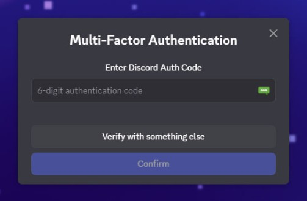

## Khi Panic Mode Được Kích Hoạt

Bạn đã bao giờ trải qua cảm giác tim như ngừng đập khi nhận ra mình vừa mất quyền truy cập vào một tài khoản quan trọng chưa? Đó chính xác là những gì tôi cảm thấy sau khi hoàn tất việc cài lại Windows - một màn hình đăng nhập Discord đang chờ đợi mã 2FA mà tôi... đã quên backup.

**"Oh sh*t moment"** - đó là cụm từ duy nhất trong đầu tôi lúc đó.

Tài khoản Discord không chỉ là nơi chat với bạn bè. Đó là:
- Hàng trăm servers với kiến thức quý giá
- Các cuộc trò chuyện công việc không thể mất
- Bot và automation đã config công phu
- Nitro subscription đang chạy...

Và giờ, tất cả sắp bay màu chỉ vì một con số 6 chữ số mà tôi không thể lấy được.

## The Lightbulb Moment 💡

Sau 30 phút ngồi nhìn màn hình với tâm trạng muốn đập máy, não tôi chợt lóe lên một ý tưởng:

> "Wait... Discord phải lưu session ở đâu đó trên máy mình chứ nhỉ?"

Và rồi một suy nghĩ khác nối tiếp:

> "Windows.old! Thư mục chứa toàn bộ dữ liệu từ Windows cũ vẫn còn đó!"

Đây chính là turning point. Từ chỗ tuyệt vọng, tôi bắt đầu thấy ánh sáng cuối đường hầm.

## The Rescue Mission

Okay, bây giờ đến phần quan trọng nhất - làm thế nào để cứu vãn tình thế. Đây là quy trình mà tôi đã thực hiện và nó đã work like a charm.

### Bước 1: Xác Nhận Windows.old Vẫn Còn Tồn Tại

Trước tiên, hãy kiểm tra xem Windows có tạo backup cho bạn không:

```bash
# Mở File Explorer, navigate đến:
C:\Windows.old\
```

**Pro tip**: Nếu bạn không thấy thư mục này, có thể bạn đã:
- Xóa nó đi (RIP)
- Cài Windows với option "Custom" và format hoàn toàn ổ cứng
- Đã quá 30 ngày và Windows tự động dọn dẹp

Nếu thư mục vẫn còn, chúc mừng! Bạn vẫn còn cơ hội.

### Bước 2: Deep Dive Vào Discord Data

Discord lưu trữ dữ liệu ở hai vị trí chính. Chúng ta cần cả hai:

**Location 1: Roaming Data (chứa settings và configs)**
```
C:\Windows.old\Users\[TênUser]\AppData\Roaming\Discord\
```

**Location 2: Local Data (chứa cache và quan trọng nhất - tokens)**
```
C:\Windows.old\Users\[TênUser]\AppData\Local\Discord\
```

Đây là những gì bạn cần tìm trong mỗi thư mục:

#### Trong Roaming:
- `Local Storage/` - Chứa authentication tokens
- `Session Storage/` - Chứa session data
- `settings.json` - User preferences

#### Trong Local:
- `Cache/` - Cached data
- `Local Storage/leveldb/` - **JACKPOT! Đây là nơi chứa token**

### Bước 3: The Great Token Migration

Bây giờ là lúc thực hiện "phép màu". Tôi khuyên bạn nên làm theo thứ tự này:

**3.1. Đóng Discord hoàn toàn**
```bash
# Mở Task Manager (Ctrl + Shift + Esc)
# Kill tất cả process liên quan đến Discord
# Hoặc dùng command line:
taskkill /F /IM Discord.exe
```

**3.2. Backup dữ liệu hiện tại (just in case)**
```bash
# Navigate đến thư mục Discord mới
C:\Users\[TênUser]\AppData\Roaming\Discord\
# Rename folder thành Discord_backup
```

**3.3. Copy toàn bộ data từ Windows.old**

Có hai cách tiếp cận:

**Option A: Copy Everything (Recommended cho người mới)**
```
Source: C:\Windows.old\Users\[TênUser]\AppData\Roaming\Discord\
Destination: C:\Users\[TênUser]\AppData\Roaming\Discord\
```

**Option B: Surgical Precision (Cho người muốn hiểu rõ hơn)**

Chỉ copy những thư mục quan trọng:
- `Local Storage\` - Contains tokens
- `Session Storage\` - Session data
- `Cookies` - Session cookies
- `IndexedDB\` - Additional stored data

Tương tự cho thư mục Local:
```
Source: C:\Windows.old\Users\[TênUser]\AppData\Local\Discord\
Destination: C:\Users\[TênUser]\AppData\Local\Discord\
```

**3.4. Verify permissions**

Windows đôi khi có thể khóa permissions. Nếu gặp lỗi:
```bash
# Right-click folder > Properties > Security
# Đảm bảo user account của bạn có Full Control
```

### Bước 4: The Moment of Truth

1. Khởi động lại Discord
2. Chờ đợi... (đây là lúc tim đập thình thịch)
3. **BOOM!** Bạn đã đăng nhập mà không cần 2FA!

Nếu thành công, bạn sẽ thấy:
- Avatar và username của bạn
- Tất cả servers
- Message history
- Everything như trước khi reinstall

## Behind The Scenes: Technical Deep Dive

Để hiểu tại sao phương pháp này hoạt động, chúng ta cần nói về cách Discord (và hầu hết các ứng dụng hiện đại) xử lý authentication.

### Discord Token Architecture

Discord sử dụng một hệ thống authentication token-based với các đặc điểm sau:

**1. Token Storage Location**
```
Local Storage/leveldb/
├── CURRENT
├── LOCK
├── LOG
├── MANIFEST-000001
└── *.ldb files  ← Tokens được lưu ở đây
```

Tokens được lưu trong LevelDB - một key-value store được Google phát triển. Đây là lựa chọn phổ biến cho Electron apps (Discord được xây dựng trên Electron).

**2. Token Lifecycle**

```
User Login
    ↓
Discord API Authentication
    ↓
JWT Token Generated (signed với secret key)
    ↓
Token Stored in Local Storage
    ↓
Every Request → Token in Header
    ↓
Server Validates Token
```

**3. Tại Sao Copy Token Vẫn Hoạt Động?**

Đây là điều thú vị:

```javascript
// Pseudo-code của Discord authentication flow
const storedToken = localStorage.getItem('token');

if (storedToken && !isExpired(storedToken)) {
    // Token vẫn còn hạn → Skip login
    authenticateWithToken(storedToken);
} else {
    // Yêu cầu đăng nhập lại
    showLoginScreen();
}
```

Discord tokens có **lifetime rất dài** (thường là vài tháng đến vô thời hạn nếu không có security event). Khi bạn copy token từ Windows.old:

1. **Token vẫn valid** - Chưa expire
2. **Device fingerprint không quan trọng** - Discord không bind token chặt chẽ với device ID
3. **IP có thể khác** - Nhưng Discord cho phép (vì user có thể di chuyển)
4. **Session persistence** - Token được design để tồn tại qua reinstalls

### The Security Implications

Đây là con dao hai lưỡi:

**Ưu điểm cho User Experience:**
- Không cần đăng nhập lại liên tục
- Seamless experience giữa các devices
- Recovery được account như case của tôi

**Rủi ro bảo mật:**
```
Nếu ai đó có physical access vào máy bạn
    → Copy thư mục Discord
        → Paste vào máy họ
            → Họ đã có full access vào account của bạn
```

**Vì sao 2FA không giúp được ở đây?**

2FA chỉ bảo vệ tại thời điểm login. Sau khi authenticated:
```
2FA Challenge → Passed → Token Generated
                              ↓
                        Token có full permissions
                              ↓
                        Copy token = Copy permissions
```

### How Discord Could Prevent This

Discord có thể implement:

1. **Device Binding**
```javascript
token: {
    userId: "...",
    deviceId: hash(hwid),  // Bind to hardware
    signature: "..."
}
```

2. **Frequent Re-authentication**
```javascript
if (timeSinceLastAuth > 7_DAYS) {
    requireReauth();
}
```

3. **Anomaly Detection**
```javascript
if (deviceChanged || ipCountryChanged) {
    sendSecurityAlert();
    requireReauth();
}
```

Nhưng tất cả đều có trade-off với user experience.

## Troubleshooting: Khi Mọi Thứ Không Như Ý Muốn

Okay, nếu bạn đang đọc phần này, có nghĩa là something went wrong. Đừng panic! Dưới đây là các vấn đề phổ biến và cách xử lý:

### Problem 1: Discord Vẫn Yêu Cầu 2FA

**Triệu chứng:**
- Bạn đã copy tất cả files
- Discord khởi động nhưng vẫn hiện màn hình login
- Vẫn yêu cầu mã 2FA

**Possible causes & solutions:**

```
Cause 1: Token đã expired
Solution: Token có thể đã hết hạn nếu bạn cài lại Windows sau nhiều tuần/tháng
→ Thử contact Discord support với backup codes

Cause 2: Copy thiếu files
Solution:
→ Kiểm tra lại cả Roaming VÀ Local folders
→ Đảm bảo copy cả leveldb folder trong Local Storage

Cause 3: Permissions issue
Solution:
→ Right-click Discord folder
→ Properties > Security > Edit
→ Đảm bảo user của bạn có Full Control
```

### Problem 2: Discord Crashes Khi Khởi Động

**Triệu chứng:**
- Discord mở lên rồi crash ngay
- Hoặc hiện white screen rồi đóng

**Solutions:**

```bash
# Method 1: Clear cache nhưng giữ token
1. Xóa Cache folder:
   C:\Users\[User]\AppData\Local\Discord\Cache\

2. Xóa GPUCache:
   C:\Users\[User]\AppData\Local\Discord\GPUCache\

3. GIỮ NGUYÊN Local Storage folder

# Method 2: Reinstall Discord nhưng backup token
1. Copy Local Storage folder ra Desktop
2. Uninstall Discord hoàn toàn
3. Cài lại Discord mới
4. Copy Local Storage folder vào lại
```

### Problem 3: "Unable to Connect" Error

**Triệu chứng:**
- Discord mở được nhưng stuck ở "Unable to connect"
- Hoặc "Connecting..." vô tận

**Solutions:**

```bash
# Check 1: Internet connection
ping discord.com

# Check 2: Discord servers status
# Visit: https://discordstatus.com

# Check 3: Firewall/Antivirus
→ Add Discord to firewall exceptions
→ Temporarily disable antivirus và test

# Check 4: DNS issues
→ Thử đổi DNS sang 8.8.8.8 (Google DNS)
```

### Problem 4: Không Tìm Thấy Windows.old

**Triệu chứng:**
- Folder Windows.old không tồn tại
- Hoặc đã bị xóa

**Alternative solutions:**

```
Option 1: Data Recovery Software
→ Sử dụng Recuva, EaseUS, hoặc tương tự
→ Scan ổ cứng tìm deleted files
→ Recover thư mục Discord

Option 2: File History (nếu đã bật)
→ Right-click Discord folder
→ Restore previous versions
→ Chọn version trước khi reinstall

Option 3: Cloud Backup
→ Check OneDrive, Google Drive
→ Xem có backup AppData không

Option 4: Contact Discord Support
→ Submit ticket với proof of ownership
→ Giải thích tình huống
→ Họ có thể disable 2FA (mất vài ngày)
```

## Best Practices: Đừng Để Bi Kịch Lặp Lại

Sau khi recover thành công, hãy làm những điều sau NGAY LẬP TỨC:

### 1. Security Hardening

```bash
 Đổi mật khẩu Discord ngay
 Setup lại 2FA (Authenticator app, không phải SMS)
 Backup recovery codes VÀO 3 NƠI:
   - Password manager (Bitwarden, 1Password)
   - Encrypted file trong cloud (Google Drive, OneDrive)
   - Physical paper trong két an toàn

 Enable "Require 2FA for guild admin actions"
 Review "Authorized Apps" trong User Settings
 Check "Devices" và revoke unknown sessions
```

### 2. Data Backup Strategy

Tạo một backup routine:

```bash
# Script để backup Discord data (chạy hàng tuần)
@echo off
set SOURCE=C:\Users\%USERNAME%\AppData\Roaming\Discord
set DEST=D:\Backups\Discord_%DATE%
xcopy "%SOURCE%" "%DEST%" /E /I /Y

# Hoặc dùng robocopy cho advanced users
robocopy "%SOURCE%" "%DEST%" /MIR /Z /LOG:backup.log
```

### 3. Pre-Reinstall Checklist

Trước khi reinstall Windows lần sau:

```
□ Backup toàn bộ AppData\Roaming
□ Backup toàn bộ AppData\Local
□ Export browser passwords & bookmarks
□ Backup SSH keys (~/.ssh)
□ Export email client data
□ Backup game saves
□ List installed programs (Ninite, Chocolatey)
□ Take screenshots của desktop & taskbar layouts
□ Document installed fonts & custom themes
```

## FAQs: Những Câu Hỏi Thường Gặp

**Q: Có phải làm vậy là vi phạm ToS của Discord không?**

A: Không. Bạn đang recover tài khoản CỦA CHÍNH BẠN. Điều này không vi phạm Terms of Service. Tuy nhiên, đừng bao giờ sử dụng technique này để access account của người khác.

**Q: Token có bị expire không? Bao lâu?**

A: Discord tokens thường có lifetime rất dài (tháng/năm). Nhưng chúng có thể invalidated nếu:
- Bạn đổi password
- Bạn revoke sessions trong settings
- Discord phát hiện suspicious activity
- Bạn enable/disable 2FA

**Q: Cách này có work với Discord PTB/Canary không?**

A: Có! Process hoàn toàn giống nhau. Chỉ cần thay "Discord" bằng "DiscordPTB" hoặc "DiscordCanary" trong paths.

**Q: Tôi có thể copy token sang máy khác không?**

A: Technically yes, nhưng KHÔNG NÊN vì:
- Rủi ro bảo mật cao
- Có thể trigger security alerts
- Vi phạm best practices
- Dùng QR code login hoặc browser thay vì

**Q: Làm sao để extract raw token từ leveldb?**

A:
```bash
# Dùng tool như DB Browser for SQLite hoặc leveldb-cli
# Nhưng không recommend vì:
1. Có thể corrupt database
2. Token được obfuscated
3. Không cần thiết - copy cả folder là đủ
```

**Q: Method này có work với các app khác không?**

A: Có! Hầu hết Electron apps (Slack, VS Code, Spotify, etc.) đều lưu data tương tự. Technique này có thể áp dụng cho:
- Slack
- Microsoft Teams
- Spotify (playlists offline)
- VS Code (settings, extensions)
- Telegram Desktop

## Kết Luận: Bài Học Từ Một Disaster

Nhìn lại toàn bộ journey này, tôi nhận ra vài điều:

### 1. Backup Không Bao Giờ Là Dư Thừa

Có câu nói trong ngành IT:
> "There are two types of people: those who backup, and those who will backup."

Tôi đã học được bài học này theo cách khó khăn. May mắn là Windows.old đã saved the day, nhưng không phải lúc nào cũng may mắn như vậy.

### 2. Understanding > Googling

Việc hiểu cách authentication tokens hoạt động đã giúp tôi tự mình tìm ra solution. Thay vì chỉ Google "how to recover Discord without 2FA", tôi research về:
- Token storage mechanisms
- Electron app architecture
- Windows file system structure

Kiến thức này valuable hơn nhiều so với một quick fix.

### 3. Security vs Convenience

Case này highlight một tension cơ bản trong tech:
- **Too much security** → Bad UX → Users find workarounds → Less secure
- **Too little security** → Easy to hack → Users lose accounts

Discord chọn lean về convenience (long-lived tokens), điều này vừa saved tôi, vừa là potential security risk.

### Final Thoughts

Nếu bạn đang đọc những dòng này trong cơn hoảng loạn giống như tôi từng trải qua — hít một hơi thật sâu. Rất có thể bạn vẫn còn cơ hội lấy lại tài khoản.

Còn nếu bạn chỉ đọc vì tò mò — hãy sao lưu mã 2FA của bạn ngay bây giờ. Đừng đợi đến khi mọi thứ sụp đổ mới hối hận.

**Remember:** The best recovery plan is the one you never have to use.


*Last updated: October 28, 2025*
*Written with ☕ and a lot of relief after recovering my account*
